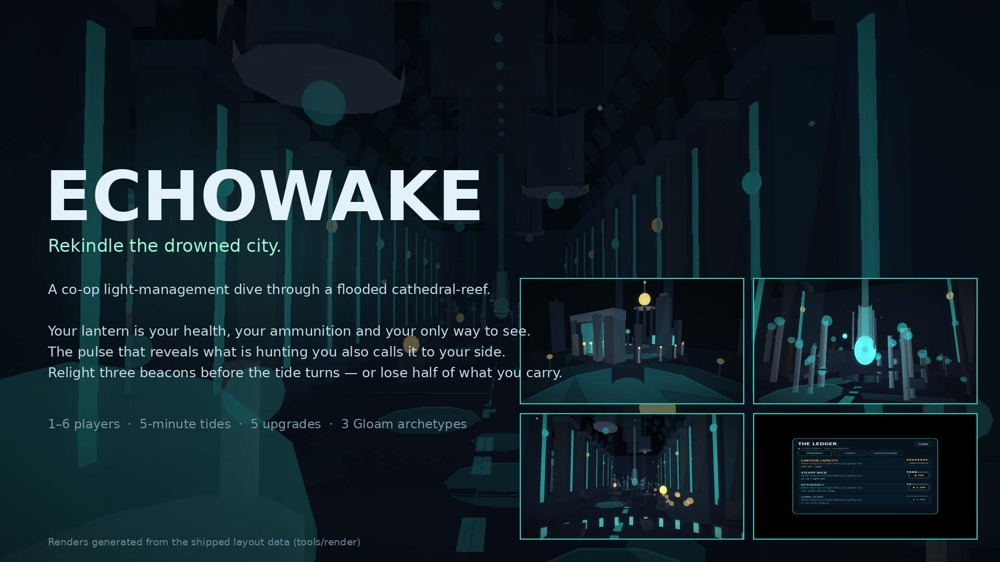

# ECHOWAKE

> **Rekindle the drowned city.**
> A co-op light-management dive through a flooded cathedral-reef, for 1–6 players.



*Screenshots in this repo are renders produced from the shipped layout data, not
Roblox engine captures — see [`screenshots/README.md`](screenshots/README.md) and the
honest status table in [`docs/TESTING.md`](docs/TESTING.md).*

You are a **Lamplighter**. Your lantern is your health, your ammunition, and the only
way to see. Below the hub, a sunken nave waits in total darkness with three dead
beacons. Relight all three before the tide turns, carry the embers home, and spend
them on a lantern that burns a little longer next time.

---

## 1. Why this game

| Pillar | What it means in play |
| --- | --- |
| **Light is everything** | Damage drains your lantern, not a health bar. Flares cost light. Sprinting burns light. Running out ends the dive. Every decision is an economic one. |
| **Sound is bait** | The pulse ([Q]) is the only way to see the Gloam — it maps every enemy in a wide radius *and* pulls all of them toward you. Information has a price. |
| **The reef is not static** | Beacons regenerate your light while lit, and the Gloam population shrinks as you relight them. Objectives double as safety. |
| **Risk is a dial you control** | Only beacons bank safely. Embers carried are halved if you're doused. You choose when to surface. |
| **Co-op is real, not cosmetic** | Beacon progress stacks with more players in range, extra players add dive time, and light regen multiplies while any beacon burns. |

Full design rationale: [`DESIGN.md`](DESIGN.md).

## 2. Controls

| Action | Keyboard / Mouse | Gamepad | Touch |
| --- | --- | --- | --- |
| Pulse (reveal + lure) | `Q` | `L1` | PULSE button |
| Flare (cone damage) | `F` or Left Click | `R1` | FLARE button |
| Sprint (burns light) | Hold `Shift` | `L3` | RUN button |
| Interact (dive gate, ledger, exit) | `E` | `X` | prompt |
| Ledger / Codex panels | `L` / `C` | — |  walk to the prop |

Movement is stock Roblox. Sprint does **not** change your hitbox or camera; it trades
light for speed.

## 3. Core loop

```
HUB  ──E──►  DIVE (5 min tide)  ──►  SURFACE  ──►  LEDGER (spend embers) ──┐
 │                 │                                                       │
 │                 ├── collect ember motes (carried, not banked)            │
 │                 ├── relight 3 beacons (safe payout + light regen)        │
 │                 ├── pulse to see, flares to cut, sprint to flee         │
 │                 └── reach the return gate once all three burn ──────────┘
 └── upgrade lantern / wick / resonance / echo / flare, recolour the lantern
```

## 4. Repository layout

```
robloxgame077/
├── default.project.json      Rojo project (place tree, Lighting/Atmosphere/FX)
├── src/
│   ├── shared/               Pure, testable game logic (no side effects at load)
│   │   ├── Config.luau       every tuning number
│   │   ├── Palette.luau      the art direction, as data
│   │   ├── Layout.luau       procedural world generator (single source of geometry)
│   │   ├── GloamBrain.luau   enemy steering/AI state machine
│   │   ├── LightMath.luau    lantern economy, cone geometry, payouts
│   │   ├── Progression.luau  upgrade catalogue + derived stats
│   │   ├── SaveSchema.luau   persistence schema, migration, sanitation
│   │   ├── Validate.luau     trust-boundary validation
│   │   ├── RateLimiter.luau  token buckets
│   │   └── Net.luau          the complete remote protocol
│   ├── server/
│   │   ├── init.server.luau  bootstrap order
│   │   ├── App.luau          service context
│   │   ├── World/Builder.luau Layout -> live Roblox instances
│   │   └── Services/         Net, PlayerData, Dive, Gloam, Leaderboard
│   └── client/
│       ├── init.client.luau  presentation loop
│       ├── Controllers/      ClientNet, Store, Controls, Lantern (VFX), SoundKit
│       └── UI/               Theme, Kit, Hud, Panels
├── tests/                    standalone-Luau specs (runnable without Roblox)
├── tools/
│   ├── check.sh              typecheck + lint + format gate
│   ├── run_tests.sh          builds and runs the test suite
│   └── render/               offline world renderer + UI mockups
├── screenshots/              rendered views and UI specs (see index)
└── docs/                     testing, architecture, security notes
```

## 5. Running it

### In Roblox Studio (the shipping path)

```bash
rojo serve            # then connect with the Rojo Studio plugin
# or build a place file directly:
rojo build default.project.json -o Echowake.rbxlx
```

Open the resulting place in Studio and press Play. `Players.CharacterAutoLoads` is off
and the server spawns characters itself once a save has loaded, so you will spawn in
the hub island after a moment.

> **DataStores** are disabled in Studio unless *Game Settings → Security → Enable Studio
> Access to API Services* is on. Without it the game runs with in-memory saves and
> prints one warning — it stays fully playable.

### Verification without Roblox

```bash
TOOLS_DIR=/path/to/bin ./tools/check.sh      # luau-lsp typecheck vs the real API dump, selene, stylua
./tools/run_tests.sh                          # 1264 assertions, 9 suites
./tools/render/build.sh                       # re-render screenshots/ from the real layout
```

Binaries needed for `check.sh`: `luau-lsp`, `selene`, `stylua` (and `luau` for tests).
None of them are vendored into the repo.

## 6. What is verified, and what is not

**Verified in this environment**

- Every Luau file typechecks under `--!strict` against the **official Roblox API
  definition dump** (`luau-lsp analyze`), with 0 errors.
- `selene` (roblox std) reports **0 errors**; `stylua --check` passes.
- 1264 assertions across 9 suites pass under a **real Luau interpreter**
  (`luau` CLI), covering validation, rate limiting, save sanitation/migration,
  progression economics, cone/falloff maths, Gloam steering/state machine, layout
  invariants and balance simulations. See [`docs/TESTING.md`](docs/TESTING.md).
- The world layout is rendered offline from the shipped layout data; composition,
  palette, fog and lighting were reviewed and iterated from those renders
  ([`screenshots/`](screenshots/)).

**Not verified here — needs Roblox Studio**

- No Roblox engine is available in this environment, so **no Studio viewport
  screenshot exists** and no in-engine playtest was run. The screenshots are
  renderer output, not engine captures (each one says so in
  [`screenshots/README.md`](screenshots/README.md)).
- Camera interpolation smoothness, particle appearance, `PointLight` shadow quality,
  HUD behaviour on real touch devices, and actual DataStore round-trips under load
  are unverified.
- Multiplayer was reasoned about and unit-tested at the logic level, but not
  playtested with two real clients.

## 7. Security posture (short version)

Server authoritative for light, damage, embers, upgrades and persistence. Every
client message is an *intent* that passes an allow-list, an exact payload-shape
check, a per-action token bucket, and a liveness check before reaching gameplay
code. Save payloads are sanitised on read. A write-lease prevents cross-server
duplication. Full mapping in [`docs/SECURITY.md`](docs/SECURITY.md).

## 8. Credits

- Design, code, world, UI and tooling: original work authored for this repository.
- No third-party models, meshes, textures, animations or audio are included.
  See [`ASSETS.md`](ASSETS.md) for the (empty) asset ledger, why it is empty, and the
  review checklist to follow if Creator Store assets are added later.
